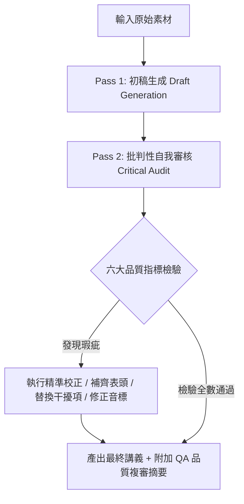

# Generate TOEIC Golden Lecture (TOEIC 金色證書講義生成與跟讀訓練)

> **摘要與用途說明**
> 專門將真實世界中的各類英文素材（新聞報導、訪談逐字稿、Podcast 錄音逐字稿、商務報告、技術文件等），自動提煉轉化為 TOEIC 860+ 金色證書等級的高密度學習講義。
> 講義頂部**強制自帶標準 YAML Frontmatter 表頭**以利知識庫管理，全面強化「詞彙語塊（Lexical Chunks / Formulaic Language）」與「口語連讀語流（Connected Speech）」，提供視覺化節奏譜輔助 Shadowing（跟讀）練習，並整合字族擴展、進階文法分析、多益 Part 5/6/7 擬真試題，且**內建二階段自我檢討審查（Two-Pass Self-Correction & Quality Gate）機制**，確保輸出零瑕疵。

---

## 1. 執行流程檢核清單 (Workflow Checklist)

處理輸入素材時，請依序完成以下 12 個標準化步驟：

```markdown
- [ ] 步驟 1：解析輸入素材資訊（標題、來源、日期），於講義頂部生成合規的【標準 YAML Frontmatter 表頭】。
- [ ] 步驟 2：檢驗輸入素材類型（逐字稿 / 商業文件 / 技術報導），保留原始文字作為【第一部分：原文保留】。
- [ ] 步驟 3：修正語法盲點、重新劃分意群、標記原稿語病，重構【第二部分：Readable 版本】。
- [ ] 步驟 4：精選並補足至少 10 個核心多益單字與片語，附英英定義、詞性、情境例句與搭配詞，產出【第三部分：TOEIC 核心單字與片語】。
- [ ] 步驟 5：提煉 3~5 組公式化語言（Formulaic Language），拆解連音、弱讀、閃音與消音，繪製跟讀節奏譜，產出【第四部分：詞彙語塊與語流連讀】。
- [ ] 步驟 6：選取關鍵字彙進行衍生詞性展開與英英例句說明，產出【第五部分：字族擴展學習】。
- [ ] 步驟 7：剖析高級商務句型、時態與文法盲點，結合考點解析，產出【第六部分：重要文法與句型解析】。
- [ ] 步驟 8：整理同義字、反義字、易混淆字與改寫技巧，產出【第七部分：觸類旁通延伸】。
- [ ] 步驟 9：依據 Readable 語境改寫設計 Part 5 (5題)、Part 6 (3題)、Part 7 (5題)，產出【第八部分：TOEIC 題型模擬出題】。
- [ ] 步驟 10：詳列標準解答、解題邏輯與干擾選項破綻，產出【第九部分：答案與精闢詳解】。
- [ ] 步驟 11：啟動【二階段自我稽核與品質審查 (Two-Pass Self-Correction)】，依據 6 大品管指標（YAML 表頭、單字量、考題唯一解、干擾項誘答度、連音標記、語塊語用）執行內部複審與校正。
- [ ] 步驟 12：於講義末端輸出【講義品質複審摘要 (Quality Assurance Summary)】，確保學習者獲得經嚴格把關之成品。
```

---

## 2. 講義 YAML Frontmatter 表頭規範 (YAML Frontmatter Specification)

輸出的 Markdown 講義開頭**必須包含合法 YAML Frontmatter 區塊**，陣列項目一律使用連字號 `-`（嚴禁使用 `*`），欄位規範如下：

```yaml
---
title: "TOEIC 金色證書精讀講義：[精煉繁體中文標題，含主題核心人物或事件]"
source: "[原始影音/文章標題、媒體名稱或來源 URL]"
published: YYYY-MM-DD # 原文發布日期（若素材未提及則填寫推估日期或 null）
created: YYYY-MM-DD   # 講義產出日期
last_edit_reason: "初始生成多益精讀講義與跟讀解析" # 或後續修訂理由
tags:
  - TOEIC
  - English-learning
  - business-English
  - [主題領域標籤，如 AI-security, semiconductor]
  - [核心考點標籤，如 lexical-chunks, connected-speech]
  - [關鍵實體標籤，如 NVIDIA, supply-chain]
---
```

- **欄位填寫原則**：
  - `title`：必須以 `"TOEIC 金色證書精讀講義："` 為前綴，簡潔點出講義核心主題。
  - `source`：完整註明材料來源（例：`"Yahoo Finance Video — AI capabilities and safety are 'one and the same': Nvidia CEO Jensen Huang"`）。
  - `tags`：必須包含 3 個通用標籤（`TOEIC`, `English-learning`, `business-English`）及 2~4 個主題專屬標籤。

---

## 3. 缺漏資訊與素材處理原則 (Material Handling Principles)

1. **口語贅字與語音辨識瑕疵 (STT Errors)**：
   - 若素材為語音轉文字（STT）產物，包含同音字錯置（如 *their/there*, *weather/whether*）或口語填充詞（*um, uh, you know*）：
     - 第一部分原貌保留，不擅自變更。
     - 第二部分務必進行校正修復，並以醒目文字標註原誤點與修訂理由。
2. **單字量不足補足機制 (Vocabulary Top-up Strategy)**：
   - 原文素材較短或用詞偏淺時，**必須主動依據該主題情境**（如供應鏈管理、金融投資、人才招聘、遠距辦公、ESG 永續等），自發補充延伸符合多益高頻測驗之核心詞彙，確保清單**絕對不少於 10 個**。
3. **長篇素材分段處理**：
   - 若使用者提供超過 1,500 字之長篇文章，優先以精華段落或前中後最具教學價值的區塊進行深構，確保 9 大模組的分析深度不被稀釋。

---

## 4. 九大核心模組規範 (9-Module Specifications)

### 第一部分：原文保留 (Verbatim Original Text)
- 100% 完整保留原始英文語料，不改動標點、大小寫或錯字。
- 作為後續比對與追蹤之基石。

### 第二部分：Readable 版本 (Enhanced Readable Version)
- 重新斷句，改善行文流暢度與排版節奏。
- 保留核心資訊，修正語法缺陷、主謂不一致或殘缺句。
- 針對修正處標示 `[修訂說明]`，說明修改原因與學習重點。

### 第三部分：TOEIC 核心單字與片語（至少 10 個）
每個單字項目皆須提供完整 4 大元素：
1. **單字 / 片語與音標**：含 IPA / KK 音標與標準詞性標籤（如 `[C]` / `[U]` / `[vt.]`）。
2. **英英精準釋義 (English Definition)**：貼近商務與職場環境之定義。
3. **實用情境例句 (Contextual Examples)**：至少 2 句（商務 / 職場 / 科技實務情境），附流暢繁體中文翻譯。
4. **常見搭配詞 (Collocations)**：列出 2~3 組黃金搭配（如動詞+名詞、形容詞+名詞）。

### 第四部分：詞彙語塊與語流連讀（Lexical Chunks & Connected Speech for Shadowing）
本模組專為口語跟讀（Shadowing）與聽力反射量身打造，包含三大核心：

#### 1. 詞彙語塊與公式化語言 (Lexical Chunks & Formulaic Language)
- 提取 3~5 組原汁原味的預製語塊（Prefabricated Chunks）：
  - **搭配型語塊 (Collocational Chunks)**：如 `strike a balance`, `mitigate the risk`
  - **慣用表達語塊 (Institutionalized Utterances)**：如 `as far as I'm aware`, `to put it mildly`
  - **句型框架語塊 (Sentence Frames)**：如 `Not only did [X], but also [Y]`, `In terms of [X], we should...`
- 註明其**語用功能 (Pragmatic Function)**（如協商談判、立場陳述、數據回報、轉折論點）與多益聽力常見置換句。
- 解說認知負荷優勢：大腦將多詞組合視為「單一檢索單位 (Single Retrieval Unit)」，使聽力與口說反應時間大幅縮短。

#### 2. 語流連讀與發音特徵解析 (Connected Speech Phenomena)
挑選關鍵語塊或句段，明確標記以下語音現象：
- **連音 (Linking / Liaison)**：
  - 子音 + 母音（Consonant to Vowel, C+V）：如 `turn over` → `/tɜːr.noʊ.vər/`
  - 母音 + 母音（Vowel to Vowel, V+V）：自然插入滑音 `/j/`（如 `see it` → `/siː ʲ ɪt/`）或 `/w/`（如 `do it` → `/duː ʷ ɪt/`）
  - 子音疊合（Consonant to Consonant）：相同爆破音僅發後者（如 `bad debt`）
- **弱讀與中性母音 (Weak Forms & Schwa /ə/)**：介系詞、冠詞、代名詞、助動詞等功能詞弱化（如 `to` → `/tə/`, `at` → `/ət/`, `can` → `/kən/`）。
- **消音與省略 (Elision)**：非重音字尾爆破音 /t/, /d/ 在子音前省略（如 `first draft` → `/fɜːs dræft/`）。
- **彈舌音 / 閃音 (Flap T / Tap T)**：美式發音中夾在兩母音間的非重音 /t/ 或 /d/ 變為快速閃音 `/ɾ/`（如 `strategy` → `/ˈstræ.ɾə.dʒi/`, `better off` → `/ˈbe.ɾər.ɔːf/`）。
- **同化 (Assimilation)**：字尾與字首音素相互影響融合（如 `would you` → `/wʊdʒuː/`, `in case` → `/ɪŋ keɪs/`）。

#### 3. 跟讀視覺標記譜 (Shadowing Rhythm Notation)
挑選 1~2 組最具跟讀訓練價值的句子，繪製節奏視覺譜：
- 標記符號規範：
  - `|`：意群停頓（Thought Group Boundary）
  - `_`：連音連結（Linking）
  - **粗體**：核心實詞重音（Sentence Stress / Focus Words）
  - `(括號)`：弱讀或被省略的音節/詞彙
  - `↗`：升調（Rising Intonation）
  - `↘`：降調（Falling Intonation）
- *範例*：`We have to **AN**a_lyze | the **MAR**ket_trend | be(fore) **MA**king_a **DEAL** ↘.`

### 第五部分：字族擴展學習 (Word Family Expansion)
- 挑選核心單字進行詞性家族拓展（動詞、名詞、形容詞、副詞）。
- 標示各衍生詞詞性、英英精要解釋，並各附 1 個道地商務例句。

### 第六部分：重要文法與句型解析 (Grammar & Sentence Structure)
- 解析 2~3 個進階語法結構（如分詞構句、倒裝句、與過去事實相反之假設語氣、複合關係代名詞）。
- 剖析「出題者思維」：多益測驗（如 Part 5）常如何針對該句構設計文法陷阱。

### 第七部分：觸類旁通延伸 (Synonyms, Confusing Words & Paraphrase)
- **同義字與反義字群 (Synonyms & Antonyms)**：提供可替換字詞並辨析語氣差異（Formal vs. Informal）。
- **易混淆字 (Confusing Words)**：辨析形近字或意近字（如 `compliment` vs. `complement`）。
- **同義改寫 (Paraphrasing Skills)**：展示如何將長句進行多益 Part 7 等級的同義換句話說。

### 第八部分：TOEIC 題型模擬出題 (Realistic Practice Questions)
嚴格仿照官方測驗格式與題型出題，素材取自 Readable 語境：
- **Part 5**：單句填空（5 題，包含詞性題、文法題、字彙搭配題）。
- **Part 6**：段落填空（3 題，包含單字填空與完整句子插入題）。
- **Part 7**：閱讀理解（5 題，包含主旨題、細節題、NOT 否定題與詞意推論題）。

### 第九部分：答案與精闢詳解 (Answer Keys & Distractor Analysis)
- 清楚標示正解選項。
- 詳解題目測驗的文法點或定位線索。
- **干擾項剖析 (Distractor Analysis)**：明確指出其餘三個選項為何錯誤（如詞性不符、時態錯置、搭配詞錯誤、語意顛倒）。

---

## 5. 二階段自我審核機制與品質閘門 (Two-Pass Self-Correction & Quality Gate)

為了徹底避免 AI 產出時常見的考題雙重答案、音標偏差或結構缺漏，本 Skill 要求 Agent 在輸出前必須執行**二階段自我檢討校對**：



### 六大核心品質檢驗維度 (Six Core Quality Metrics)

1. **YAML Frontmatter 表頭完整性 (YAML Frontmatter Compliance)**：
   - 檢核：頂部是否有完整的 `title`, `source`, `published`, `created`, `last_edit_reason`, `tags`？清單是否嚴格使用 `-`？
   - 處置：若缺漏立即補齊，確保符合 Obsidian 與知識庫讀取規範。
2. **單字量與結構完整性 (Vocabulary Quantity & Structural Completeness)**：
   - 檢核：核心單字清單是否**實質達到 $\ge 10$ 個**？
   - 處置：若低於 10 個，強制依據素材產業主題（如採購、金融、人事等）補足衍生高頻單字。
3. **多益考題唯一解驗證 (Key Uniqueness Verification)**：
   - 檢核：Part 5/6/7 每道題目的正確答案是否**具備絕對唯一性**？
   - 處置：仔細比對 3 個干擾選項，確認沒有任何選項可作為次佳解或在其他語境下成立。若有模糊地帶，立即修改干擾項。
4. **干擾項設計合理性 (Distractor Validity & Plausibility)**：
   - 檢核：干擾選項是否具備多益真實誘答力（如詞性混淆、形近字、反向邏輯），而非明顯無效的拼湊單字？
   - 處置：重寫不具備迷惑性的選項，確保題目的測驗鑑別度。
5. **連音與語流標記精準度 (Connected Speech & Phonetic Accuracy)**：
   - 檢核：連音符號 `_`、母音間滑音 `/j/` 與 `/w/`、弱讀母音 `/ə/` 以及美式閃音（Flap T `/ɾ/`）是否精準無誤？
   - 處置：修正不符母語口音規律的錯誤連音標記。
6. **語塊道地性與實用價值 (Chunk Authenticity & Pragmatic Value)**：
   - 檢核：選出的 3~5 組詞彙語塊是否為真實母語慣用語塊，而非隨機斷句？語用功能說明是否明確？

---

## 6. 輸出範例結構 (Template Structure)

```markdown
---
title: "TOEIC 金色證書精讀講義：NVIDIA CEO Jensen Huang 談 AI 能力與安全"
source: "Yahoo Finance Video — AI capabilities and safety are 'one and the same': Nvidia CEO Jensen Huang"
published: 2026-10-21
created: 2026-11-10
last_edit_reason: "初始生成講義與 Shadowing 語流解析"
tags:
  - TOEIC
  - English-learning
  - business-English
  - AI-security
  - zero-trust
  - NVIDIA
---

# TOEIC 金色證書精讀講義

## 第一部分：原文保留
[完整原始英文]

## 第二部分：Readable 版本
[修訂與排版後的英文]
> [修訂註記]：...

## 第三部分：TOEIC 核心單字與片語
1. **單字 (IPA)** [詞性]
   - **英英釋義**：...
   - **常見搭配**：...
   - **實用例句**：
     - (1) ...
     - (2) ...

## 第四部分：詞彙語塊與語流連讀
### 1. 核心詞彙語塊 (Lexical Chunks)
- `[語塊]`：[語用功能與商務情境應用]
### 2. 語流連讀特徵 (Connected Speech)
- [連音 / 弱讀 / 閃音 / 消音 解析]
### 3. 跟讀視覺標記譜 (Shadowing Notation)
- `[帶有 | _ **重音** () ↗ ↘ 符號之標記句]`

## 第五部分：字族擴展學習
- `原字 (v.)` → `衍生名詞 (n.)` / `衍生形容詞 (adj.)`

## 第六部分：重要文法與句型解析
- [核心文法考點剖析]

## 第七部分：觸類旁通延伸
- 同義字 / 易混淆字 / 同義改寫

## 第八部分：TOEIC 題型模擬出題
- Part 5 (5 題)
- Part 6 (3 題)
- Part 7 (5 題)

## 第九部分：答案與精闢詳解
- [正解與干擾選項破綻分析]

---

## 講義品質複審摘要 (Quality Assurance Summary)
> - **YAML 表頭與模組覆蓋**：表頭中繼資訊齊全；已收錄 10+ 個核心詞彙，9 大模組結構完整度 100%。
> - **考題唯一性檢驗**：已逐題複核 Part 5/6/7，所有題目正解均具唯一性，干擾項具備合理誘答力。
> - **語音語流校準**：已複核連音標記、美式閃音 (Flap T) 與跟讀視覺譜，符合自然語流規律。
> - **自我修訂紀錄**：[若初稿無瑕疵填寫「初審完全通過」；若有微調則條列說明，例如：微調 Part 5 第 2 題干擾選項 (C) 避免爭議雙解]
```

---

## 7. 版本歷史與變更記錄 (Changelog & Diff History)

| 版本 | 日期 | 修改重點 | 調整動機 / 對照說明 |
| :--- | :--- | :--- | :--- |
| `1.2.0` | 2026-11-11 | 增加講義 YAML Frontmatter 表頭規範 | 強制要求產出講義頂部具備標準 YAML 表頭（title, source, published, created, last_edit_reason, tags），並納入二階段品質檢核維度 |
| `1.1.0` | 2026-11-11 | 導入二階段自我稽核與品質閘門 (Quality Gate) | 新增 Pass 2 審核流程，強制執行品質檢驗，並在文末增設 QA 品質複審摘要 |
| `1.0.0` | 2026-11-08 | 初版建立 (移植自 prompt v2.6.0) | 建立完整 9 大模組之 Agent Skill 規範，強化詞彙語塊 (Lexical Chunks)、連音弱讀 (Connected Speech) 與視覺化跟讀譜 (Shadowing Notation) |
